<h3><code>mert@york ~ $ whoami</code></h3>

<table>
<tr>
<td valign="top"></td>
<td valign="top"></td>
</tr>
</table>

### Mert Olgun

Second-year **BSc Computer Science with Artificial Intelligence** student at the **University of York**.

### Stack

C, C#, TypeScript, Rust, JavaScript, HTML, CSS, Python, Java, PowerShell, and Git.

The desktop workbench is TypeScript and Rust, with JavaScript, HTML, and CSS on the interface. Java is a separate repository. Python regenerates the contribution graph on this page.

 

<h3><code>mert@york ~ $ ./contributions.sh</code></h3>

