<h3><code>mert@york ~ $ whoami</code></h3>

<table>
<tr>
<td valign="top"></td>
<td valign="top"></td>
</tr>
</table>

### Mert Olgun

Second-year **BSc Computer Science with Artificial Intelligence** student at the **University of York**. I am preparing for a **summer 2027 technical internship**.

This page says who I am, what a visitor can actually open, and how to reach me.

### Now · October 2026

This term I am studying software and systems engineering, operating systems, security, networking, and computability. Machine learning and data science are on this year's module list. I will talk about them after the work is done.

### What is public

A repository gets pinned when it has a README, a way to run it, and tests. Until then the pin area can stay quiet.

Still private, so not pinned:

- **Qutra Labs** — a local-first desktop operations workbench in TypeScript.
- **Eva** — barcode reading inside a real workflow. My own part is not written up yet.

### Stack

Python, Java, TypeScript, and Git.

### Contact

[samilolgun27@gmail.com](mailto:samilolgun27@gmail.com)

 

<h3><code>mert@york ~ $ ./contributions.sh</code></h3>

Public activity only. Regenerated daily in this repository from GitHub's public calendar.

